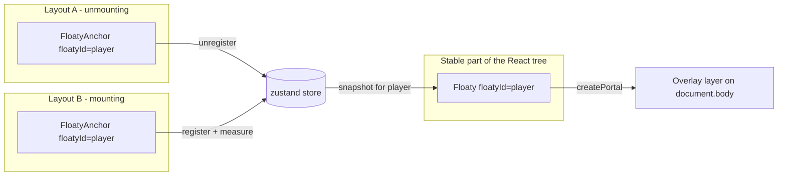
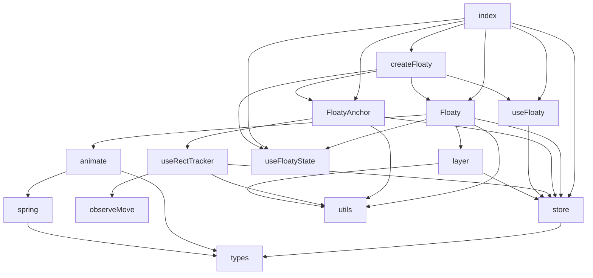
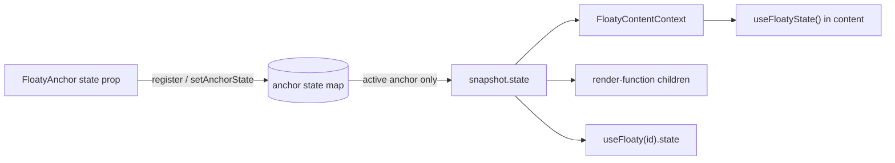
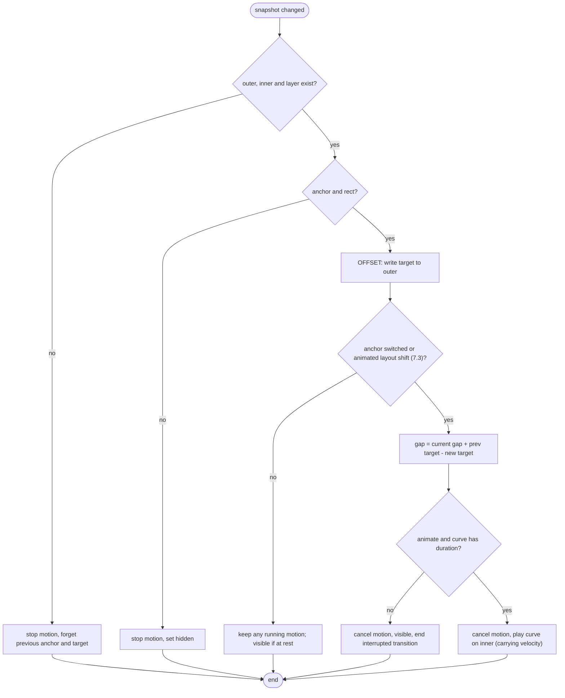
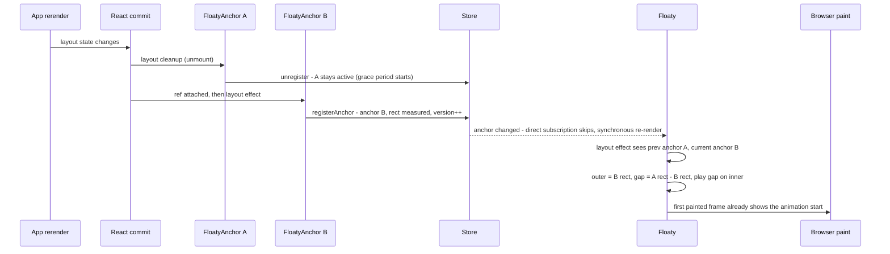

# @floaty/react: Architecture

| | |
| --- | --- |
| Status | Current (v0.1.0) |
| Audience | Contributors and maintainers |
| Scope | Runtime architecture, data flow, animation model, packaging, testing, trade-offs |

For usage, see the [README](./README.md) or the docs site (`apps/docs`). Paths such as
`src/` and `tests/` are relative to `packages/react/`; `apps/` and `e2e/` are relative to
the repository root.

---

## 1. Problem statement

In React, an element's state is tied to its **position in the tree**. When an app switches
between layouts (grid to list, page to sidebar, full player to mini player), the subtree
for the old layout unmounts and the new one mounts. Anything rendered inside it, such as a
video player, a form, a map, or a WebSocket-backed widget, **loses its state and is
re-created**, and there is no visual continuity between the old and new positions.

The usual workarounds each have drawbacks:

| Workaround | Drawback |
| --- | --- |
| Lift state up / external store | Only works for serializable state; DOM state (video playback, iframes, canvas, focus, scroll) is still lost |
| Keep both layouts mounted and toggle with CSS | Doubles the render cost and duplicates the stateful component |
| Physically move DOM nodes (reparenting) | React does not support it; it breaks reconciliation and event handling |

**Floaty** takes a different approach: the stateful content is rendered **once**,
in a stable location in the tree, into an **overlay layer** on top of the page. Layouts only
render lightweight **placeholders** (anchors). The overlay measures the active anchor and
positions the content over it, animating between anchors when the layout changes.

## 2. Goals and non-goals

**Goals**

- Keep both React state and DOM state of floating content across arbitrary layout changes.
- Visual continuity: animate (FLIP) between old and new positions with an easing curve or a
  spring, or snap on request. Interruptions (scroll, layout shifts, new anchors) never
  restart the motion from rest.
- Minimal API: one component for content, one for placeholders, an optional hook.
- No provider required; works anywhere in the tree.
- Small footprint: no animation library; only `react`, `react-dom` and `zustand`.
- Respect `prefers-reduced-motion`.
- SSR-safe: no DOM access during render.

**Non-goals**

- General-purpose shared-element transitions between arbitrary elements (as in
  framer-motion's `layoutId`). Only `Floaty` content moves; anchors are static boxes.
- Clipping content to scroll containers. Floating content sits above the page and is
  not clipped by `overflow: hidden` ancestors of the anchor (see section 12).
- Animating content opacity or appearance. Only position and size are animated.

## 3. Conceptual model

Three concepts:

| Concept | Component | Responsibility |
| --- | --- | --- |
| **Content** | `<Floaty floatyId>` | Owns the stateful children; renders them once into the overlay layer |
| **Anchor** | `<FloatyAnchor floatyId>` | A plain `div` that reserves space in a layout and reports its viewport rect |
| **Channel** | `floatyId` (string) | Connects one content to any number of anchors |

For each `floatyId`, **at most one anchor is active**: the one with the highest `priority`
(default `0`), and among equal priorities the most recently mounted one. When the active
anchor unmounts, the next one by the same rule becomes active again (ADR-6).



## 4. Module map

```text
src/
  index.ts           Public exports
  types.ts           Shared types: FloatyRect, FloatySnapshot, FloatyTransition, ...
  store.ts           zustand store: anchor stacks, snapshots, config; geometry helpers
  layer.ts           Shared overlay layer: lazy creation, ref counting, config styling
  Floaty.tsx         Content component: portal, positioning, animation decisions
  FloatyAnchor.tsx   Placeholder component: registration, active-state subscription
  useRectTracker.ts  Measurement triggers for the active anchor (resize, scroll, RO, moves)
  observeMove.ts     IntersectionObserver-based detection of moves without resize
  useFloaty.ts       Read-only status hook (incl. anchor state) + remeasure()
  useFloatyState.ts  Content context + useFloatyState()/useFloatyTransition() inside content
  createFloaty.tsx   Typed channels: components and hooks bound to one floatyId and state type
  animate.ts         Motion curves (easing, spring) for the delta, WAAPI + rAF drivers, easing solver
  spring.ts          Closed-form damped harmonic oscillator, parameter mapping, settle time
  utils.ts           useIsomorphicLayoutEffect
```

Dependency direction (no cycles):



## 5. State model

### 5.1 Store shape (`src/store.ts`)

A single module-level vanilla zustand store (`createStore` from `zustand/vanilla`),
consumed from React via `useStore(floatyStore, selector)`.

```ts
interface FloatyState {
  config: FloatyConfig;                         // zIndex, transition, layerClassName, anchorGracePeriod
  anchors: Record<string, HTMLElement[]>;       // mounted anchors per floatyId; last = active
  snapshots: Record<string, FloatySnapshot>;    // derived, immutable per floatyId
  owners: Record<string, object[]>;             // mounted Floaty instances; first = renders
  registerAnchor(floatyId, el, state?, priority?): () => void;  // returns unregister
  setAnchorPriority(floatyId, el, priority): void;  // re-picks the active anchor
  setAnchorState(floatyId, el, state): void;    // shallow-compared; mirrored only if el is active
  measure(floatyId, reason?): void;             // re-measure active anchor; no-op if unchanged
  setAnimating(floatyId, isAnimating): void;
  retain(floatyId): () => void;                 // keeps the entry alive; returns release
  claimFloaty(floatyId, token): () => void;     // registers a Floaty instance; returns unclaim
}
```

Per-anchor `state` values live in a module-level `Map<HTMLElement, unknown>` next to the
store, not in store state. Only the **active** anchor's state is mirrored into the snapshot,
so state changes on inactive anchors never notify subscribers.

**Garbage collection.** An id's `anchors` and `snapshots` entries are deleted once the id is
unused: no registered anchors, no pending grace period (section 9.1), and no holders.
Holders are counted in a module-level `Map<string, number>` (not store state, so
retaining never notifies subscribers); `Floaty` and `useFloaty` retain their id from a
layout effect until they unmount. The check runs in a microtask after the last anchor or
holder goes away, so anything that unmounts and remounts within one commit (StrictMode
effect replays, key changes, layout swaps) keeps the entry. Dynamic ids (per list item,
per route) therefore don't accumulate.

### 5.2 Snapshot

```ts
interface FloatySnapshot {
  anchor: HTMLElement | null;   // active anchor element
  rect: FloatyRect | null;      // last known viewport rect; kept after the anchor goes away
  state: unknown;               // active anchor's `state` prop; kept after the anchor goes away
  reason: 'anchor' | 'layout' | 'scroll';
  version: number;              // bumped only when anchor or rect changes
  isAnimating: boolean;
}
```

Design notes:

- **Immutable and replaced on change.** Each snapshot object is stable until something
  changes, so selectors like `state.snapshots[id] ?? EMPTY_SNAPSHOT` return referentially
  stable values and components only re-render for their own `floatyId`.
- **`version` is the positioning signal.** `Floaty` positions on `version` changes
  (section 6.3), not on every snapshot change. Toggling `isAnimating` does not bump
  `version`, so reporting animation status never re-triggers positioning (no feedback loop).
  The same applies to `state`: changing it re-renders content but never repositions it.
- **`rect` survives anchor removal while the id is retained.** It records where the content
  last was, which is useful for `useFloaty` consumers. Once nothing reads the id, the entry
  is collected (section 5.1) and later reads see `EMPTY_SNAPSHOT`. An anchor arriving within the grace period animates
  from it (section 9.1); after that, content is hidden and a later anchor snaps rather than
  animating from a stale position.
- **`reason`** tells `Floaty` *why* the rect changed, which drives the animate-or-snap
  decision (section 7.3).

### 5.3 Store operations

| Operation | Effect |
| --- | --- |
| `registerAnchor(id, el, state, priority)` | Records `state` and `priority`, moves `el` to the end of `anchors[id]` (registration order), and picks the active anchor (ADR-6); if it changed, measures it, copies its `state`, sets `reason: 'anchor'`, `version++` |
| `setAnchorPriority(id, el, priority)` | No-op if unchanged; otherwise records it and re-picks the active anchor, switching (and animating) if it changed |
| unregister (returned fn) | Removes `el`, its state and priority; if it was active, activates the next pick. If none remain, `el` stays the snapshot's (detached) anchor for `anchorGracePeriod` ms, then the anchor becomes `null`, keeping `rect` and `state` (section 9.1) |
| `setAnchorState(id, el, state)` | No-op if shallow-equal; otherwise records it and, if `el` is active, patches `snapshot.state` without bumping `version` |
| `measure(id, reason)` | Reads `getBoundingClientRect()` of the active anchor; updates only if the rect differs; no-op while the anchor is detached (grace period) |
| `setAnimating(id, b)` | Updates `isAnimating` without bumping `version` |
| `configureFloaty(opts)` | Shallow-merges config; `transition` goes through `resolveTransition` (springs replace, easing objects merge into the current easing default) |
| `retain(id)` | Increments the id's holder count; the returned release decrements it (idempotent) and schedules collection at zero |
| `claimFloaty(id, token)` | Appends a `Floaty` instance to `owners[id]` (warning once per id in development if one is already there); unclaim removes it, promoting the next instance |
| `resetFloaty()` | Restores initial state (tests) |

## 6. Component internals

### 6.1 `FloatyAnchor`

1. Holds its element in a **ref** (not state), merged with any forwarded ref.
2. In a **layout effect** keyed on `floatyId`, calls `registerAnchor` with the current
   `state` (read from a ref so registration does not re-run on state changes); the cleanup
   unregisters.
3. A second layout effect keyed on `state` calls `setAnchorState`. The store compares it
   shallowly, so passing `state={{ ... }}` inline is cheap. A third, keyed on `priority`,
   calls `setAnchorPriority` (registration reads the initial priority from a ref).
4. Subscribes to a boolean selector: "am I the active anchor for this id?"
5. While active, `useRectTracker` keeps the rect fresh.
6. A dependency-free layout effect calls `measure(id, 'layout')` after every render while
   active, catching moves caused by parent re-renders that don't resize the anchor.
7. Spreads remaining props onto the `div`, so a native `id`, `className`, `style`, ARIA
   attributes and so on all work.

### 6.2 `useRectTracker`

While the anchor is active, it attaches:

| Source | Reason reported |
| --- | --- |
| `ResizeObserver` on the anchor | `layout` |
| Move observer on the anchor (`observeMove`, below) | `layout`, or `scroll` within 100 ms of a scroll/resize event |
| `window` `scroll` (capture phase, so nested scroll containers count) | `scroll` |
| `window` `resize` | `scroll` (snaps; if the anchor itself resizes, its `ResizeObserver` usually reports `layout` in the same frame, which wins) |

Triggers are coalesced into **one measurement per animation frame**. If both kinds of
trigger fire in the same frame, `layout` takes precedence over `scroll`, because a real
layout shift should animate even if a scroll happened in the same frame.

**Move observer (`src/observeMove.ts`).** Moves that neither resize the anchor, scroll
anything nor re-render it (an image loading or a sibling expanding above it) are caught
with an `IntersectionObserver` whose `rootMargin` shrinks the root to the anchor's own
rect (the technique of Floating UI's `autoUpdate({ layoutShift: true })`):

- The threshold is the anchor's current visible ratio (`1` when fully on screen), so any
  move changes the ratio and fires the callback; the observer is then rebuilt around the
  new rect. A partially visible anchor re-arms at its starting ratio; an anchor entirely
  off screen is re-checked every second. Sub-pixel moves that keep the ratio at `1` are
  caught by comparing the rect when the callback fires.
- Scrolling also moves the anchor in the viewport and fires the observer, so a move
  reported within 100 ms of a `scroll` or `resize` event is attributed to it (`scroll`,
  snaps). A genuine layout shift during that window therefore snaps instead of animating.
- It is a no-op where `IntersectionObserver` is unavailable (SSR, old browsers).

Only the **active** anchor installs listeners, so the cost is per `floatyId`, not per anchor.

### 6.3 `Floaty`

1. Acquires the shared layer via `useFloatyLayer()` (section 8), and claims its
   `floatyId` with a per-instance token. **One `Floaty` per `floatyId`:** if several are
   mounted, only the first one renders and positions; the others render `null` (and a
   development warning is logged once per id). When the first unmounts, the next one in
   mount order takes over with freshly mounted content. A `Floaty` only clears
   `isAnimating` on unmount if it was running the transition itself, so an idle duplicate
   can't clear the owner's flag.
2. Subscribes for rendering only to what it renders: the snapshot's `anchor`, `state` and
   `isAnimating`, plus `config.transition` and whether a `rect` exists (which flips once).
   It never re-renders for `rect` changes. It retains its
   `floatyId` (section 5.1) while mounted; `useFloaty` retains its id the same way.
3. Returns `null` until the layer exists (SSR and first client render), while there is
   no anchor and `keepMounted={false}`, or while the snapshot has no `rect` yet and
   `keepMounted="afterAnchor"` (it also subscribes to the boolean `rect !== null` for this).
4. Otherwise portals two nested `div`s into the layer:
   - **Outer** (`data-floaty`): `position: absolute; top: 0; left: 0; pointer-events: none`.
     Always sits exactly on the target rect (the *offset*, section 7.2) and carries
     `visibility`, `aria-hidden` and `data-floaty-state`. It is never animated.
     Its `style` prop also carries the snapshot rect's `width` and `height`, read at
     render (see "First mount sizing" below).
   - **Inner** (`data-floaty-content`): the visible box around `children`. Rests at
     `width: 100%; height: 100%` of the outer, has `pointer-events: auto`, receives the
     user's `className` and `style`, and runs the transition (the *delta*).
5. One **positioning routine** (section 7) runs from two places, guarded so each snapshot
   `version` is applied once per outer element:
   - a **layout effect** keyed on `anchor`, `layer`, `floatyId`, `keepMounted`, ownership
     and whether a rect exists (the outer element may mount later), which
     reads the store's current snapshot. Anchor changes are always positioned here, after
     React re-renders, so a swap within one commit is seen as one switch (section 9);
   - a **store subscription** (set up by that effect) that positions version changes of
     the anchor already positioned (scroll, layout shifts) directly, without a render.
     It ignores snapshots whose anchor differs from the last positioned one.

Positioning is applied **imperatively** (outer: `transform`, `width`, `height`,
`visibility`, `data-floaty-state`; inner: animations only) rather than through React's
`style` prop. That keeps high-frequency updates (scroll) out of React reconciliation, and
lets the Web Animations API own the inner element during transitions. React only controls
the static styles; user `style` is merged into the inner element and should avoid
`transform`, `width` and `height`.

**First mount sizing.** Layout effects run children first, so content's own layout
effects (and refs) run *before* `Floaty`'s positioning effect. If positioning were the only
writer of the outer size, self-measuring content (charts, maps, video, virtualized lists)
would read `0 × 0` on mount. So the outer `style` prop includes the current snapshot
rect's size: the outer box already has the size when the content's layout effects run.
This does not fight the imperative writes, because the value read at render always equals
what positioning applies for the same snapshot (both are the anchor's measured size, in
the same `px` format), and React only writes it when it differs from the previous render.
It also covers hidden content: a `Floaty` that mounts while there is no anchor still
starts at the last known size, kept in the snapshot while it is retained (section 5.1).

The only case left without a size is content mounted before *any* anchor has been
measured. With `keepMounted` `true` (the default) it mounts hidden at `0 × 0`;
`keepMounted="afterAnchor"` defers the first mount until the snapshot has a rect, then
behaves like `true`. The default stays `true` so content that doesn't measure itself can
start work (loading media, fetching) before its first anchor appears.

Scrolling and layout shifts don't render `Floaty` at all, so render-function children are
called only when `anchor`, `state` or `isAnimating` change. When `Floaty` does render for
other reasons, plain `children` keep their element identity and the content context value
is memoized on `state`, so React bails out of that subtree.

`useFloaty` tracks which fields a component reads (`hasAnchor`, `isAnimating`, `rect`,
`state`, through getters, like SWR) and, via `useSyncExternalStore`, re-renders only when
one of those changes. Reading `rect` opts into per-frame updates while scrolling; reading
only `hasAnchor` or `state` does not. Unread fields are refreshed in place on the cached
result, so a field read for the first time in a later render is never stale.

### 6.4 Anchor state flow

Anchor state lets one stateful component adapt per layout (for example, a full player in
the grid and a mini player in the sidebar) without remounting.



- `Floaty` provides `FloatyContentContext` (`{ floatyId, state, settledState, isAnimating }`)
  around its content, so any descendant can call `useFloatyState()` or
  `useFloatyTransition()`. Because context crosses portals, this works even though the
  content lives in the overlay layer.
- On an anchor switch, the new anchor's state is copied into the snapshot **in the same store
  update** that changes `anchor` (section 9). Content that renders from `state` therefore
  re-renders into its new form in the same frame the animation starts, and the box morphs
  from the old size to the new one while the new form is already showing.

**Choosing when content changes form.** Switching at take-off suits content that reflows
gracefully. Content whose new form only fits the new box (a mini player's controls, a
compact card) looks wrong at the old size, so `Floaty` also tracks a **`settledState`**:
the state of the anchor the content is resting on.

| Value | Switches | Use for |
| --- | --- | --- |
| `state` | When the transition starts | Forms that reflow well while the box resizes |
| `settledState` | When the content lands (or immediately if the move snaps) | Forms that only fit the destination box |
| both, with `isAnimating` | Custom | Cross-fades or intermediate forms, e.g. render `settledState`'s form with a fade towards `state`'s |

`settledState` is local React state in `Floaty`, updated by a layout effect keyed on
`state` and `isAnimating` that copies `state` whenever no motion is running. Because it is
declared after the positioning effect, an animated anchor switch has already started its
motion when it runs, so `settledState` keeps the previous value, and no committed render
shows the new form early. It follows `state` once the transition finishes or stops (anchor
gone, snap on retarget), and immediately for snaps (`transition={false}`, reduced motion),
first placement and `state` changes at rest. A retarget mid-flight keeps the original
`settledState` until the final landing; `state` changes during a flight apply on landing.
It is exposed through `useFloatyTransition()` and the render-function status.
- Because only element types and positions decide whether React keeps component state,
  content keeps its hooks and state across state changes. Effects that depend on state
  values re-run, which is the intended way to "change logic" per layout.

## 7. Positioning and animation

### 7.1 Coordinate system

- The store keeps **viewport** rects (`getBoundingClientRect()`).
- The layer is `position: absolute` at the **document origin** (`top: 0; left: 0`, zero
  size, `overflow: visible`). Each floaty's outer element uses one of two placements,
  chosen per active anchor:

| Placement | When | Outer element | Target |
| --- | --- | --- | --- |
| Document | default | `position: absolute` inside the layer | `relativeTo(anchorRect, layerRect)`: anchor minus layer origin, i.e. document coordinates |
| Fixed | the anchor or an ancestor has computed `position: fixed` | `position: fixed` | the anchor's viewport rect |

- **Why:** browsers scroll the page on the compositor thread, ahead of JavaScript. With
  document placement the page scroll moves the layer and the anchor equally, so the
  target does not change and the content scrolls natively in the same frame as the page.
  Anchors in fixed containers do not move with the page, so their floaties are fixed too.
  JavaScript re-measurement is only needed when the anchor moves *relative to its
  placement*: nested scroll containers, sticky anchors while stuck, layout shifts.
- The placement is re-evaluated (an ancestor walk with `getComputedStyle`) when the anchor
  changes or on `layout` measurements, never on scroll. Switching placement only changes
  the outer element's CSS `position`, so no DOM node moves and iframe/video state is kept.
- Gaps between placements are computed in viewport space: each target is converted with
  `toViewport` (document targets add the current layer origin) before
  `Δ += prev − next`, so switching between a fixed and a page anchor after scrolling
  animates the on-screen distance.
- `Floaty` skips the style write when the target and placement are unchanged (the common
  case on page scroll).
- The outer element is placed with `translate3d(x, y, 0)` plus explicit `width` and
  `height`. The transform keeps movement on the compositor; the size change is a layout of
  the content only, which keeps it simple and accurate (no scale distortion of text or
  video).

### 7.2 Offset and delta

Every rendered rect is split into two parts:

\[
\text{visual}(t) = \text{target} + \Delta(t), \qquad \Delta(t) \to 0
\]

- **Offset (target):** the active anchor's rect in layer coordinates, written directly to
  the outer element on every snapshot change. Scrolling only ever changes the offset.
- **Delta (Δ):** the gap between what is on screen and the target when a transition
  starts. Only Δ is animated, on the inner element and on its own clock, as
  `translate3d(Δx, Δy, 0)`, `width: calc(100% + Δw)`, `height: calc(100% + Δh)`, down to
  zero.

Because the inner element is drawn relative to the outer one, a target change that is
not a transition (a scroll, or a layout shift that rides along) moves the outer element
and the running animation keeps going untouched: no restart, no remaining-time
bookkeeping, no layout read.

When a transition is (re)started, the new gap is computed without reading layout:

\[
\Delta_{\text{new}} = \Delta_{\text{current}} + \text{target}_{\text{prev}} - \text{target}_{\text{new}}
\]

`Δ_current` and its velocity come from the running motion's curve evaluated at its
current time (zero at rest). Springs also take the current velocity, so momentum carries
through the interruption; easing curves restart their easing from the carried-over gap.



Key properties:

- **Interruptible without restarts.** Scrolls never touch the motion; retargets continue
  from the current on-screen gap (and velocity, for springs).
- **Resting state is always in inline styles.** The outer element always holds the target,
  and the inner element's resting styles (`100%` size, no transform) are static. Animations
  use `fill: none`, so cancelling or finishing leaves the box exactly on the target.
- **Lifecycle callbacks** fire once per continuous transition: `onTransitionStart` when
  movement begins from rest, `onTransitionEnd` when it finishes, is resolved by a snap, or
  is cancelled because the anchor went away (so start and end always pair up). Retargeting
  mid-flight does not re-fire `onTransitionStart`. Unmounting `Floaty` mid-flight cancels
  the animation and clears `isAnimating` without calling `onTransitionEnd`.

### 7.3 Animate-or-snap decision

A **retarget** (new Δ) happens on these triggers, provided
`transition !== false && !prefersReducedMotion()`; otherwise the trigger snaps:

| Trigger | Condition |
| --- | --- |
| Anchor switched | previous anchor was non-null and differs from the current one |
| Layout shifted at rest | same anchor, `reason === 'layout'`, `animateLayoutChanges`, nothing running |
| Layout shifted mid-flight (springs only) | same anchor, `reason === 'layout'`, `animateLayoutChanges`, motion running, spring transition |

Everything else only updates the offset:

- **First placement**: there was no previous anchor (initial mount, or re-anchoring after a
  period with no anchor). Flying in from an invisible, stale position would look wrong.
- **Scroll**, at rest or mid-flight: page scroll moves the box natively (section 7.1);
  nested-container scroll updates the target; a running transition continues toward the
  moving target either way.
- **Layout shift mid-flight with easing**: the box jumps with the anchor, like scroll.
  Easing has no velocity to carry, so restarting it would visibly stall; springs absorb
  the shift instead.
- `transition={false}` or reduced motion.

### 7.4 Motion engine (`src/animate.ts`, `src/spring.ts`)

A **curve** describes Δ (and its velocity) from its start value to zero:
`{ duration, at(t) => { delta, velocity }, easing? }`. `createCurve(config, delta, velocity)`
builds one per transition type:

- **Easing:** `Δ(t) = Δ₀ · (1 - ease(t / duration))`, velocity by finite difference.
  Named CSS easings and `cubic-bezier(...)` are evaluated with a bisection-based
  cubic-bezier solver (invalid input falls back to `ease-in-out`), which is used both for
  the rAF fallback and for reading the current gap of a running WAAPI animation.
- **Spring:** one damped harmonic oscillator per axis, solved in closed form
  (`springAt`: underdamped, critically damped and overdamped cases), starting from the
  axis's gap and velocity. `duration` is the slowest axis's settle time (within 0.5 px and
  5 px/s, capped at 10 s). Position (x, y) uses the configured spring; size (width,
  height) uses `bounceSize`, which defaults to the same frequency critically damped so the
  box never overshoots its size.

Spring parameters (unit mass, time in seconds):

| Attributes | Mapping |
| --- | --- |
| Physical `{ stiffness, damping, mass = 1 }` | `ω₀ = √(k / m)`, `ζ = c / (2√(k·m))` |
| Visual `{ duration, bounce = 0 }` | `ω₀ = 2π / duration`, `ζ = 1 - bounce` (`bounce ≥ 0`) or `1 / (1 + bounce)` (`bounce < 0`) |

A curve is played on the inner element by a driver that returns a `Motion`
(`current()`, `cancel()`):

- **Primary: Web Animations API.** Easing curves play as two keyframes with the CSS
  easing. Spring curves are sampled at 60 Hz into keyframes played with
  `easing: 'linear'`; sampling keyframes (rather than a CSS `linear()` easing) lets each
  axis follow its own shape after a retarget. `current()` evaluates the curve at
  `animation.currentTime`. `cancel()` clears `onfinish` first, so a cancelled animation
  never reports completion.
- **Fallback: `requestAnimationFrame`** when `element.animate` is unavailable. It writes
  the inner element's Δ styles each frame and restores its resting styles on finish or
  cancel. The outer element is written the same way in both paths.

Transition configs are resolved by `resolveTransition(transition, base)` (`src/store.ts`):
`false` snaps; `{ type: 'spring', ... }` is used as given; other objects are easing
transitions whose missing fields come from the base when it is an easing, or from
`DEFAULT_TRANSITION` when the base is a spring.

## 8. Overlay layer lifecycle (`src/layer.ts`)

- A single `div[data-floaty-layer]` is appended to `document.body`, styled
  `position: absolute; top: 0; left: 0; width: 0; height: 0; pointer-events: none` (the
  document origin, section 7.1). Each floaty's outer element also has
  `pointer-events: none` and its inner (visible) element sets `pointer-events: auto`, so
  only the visible content captures input, including mid-transition.
- **Ref-counted.** Each mounted `Floaty` acquires the layer in a layout effect and releases
  it on cleanup. The layer is created on first acquire and removed on last release. This is
  safe under React StrictMode's double effect invocation (acquire, release, acquire).
- **Reactive config.** While the layer exists, it subscribes to the store and re-applies
  `zIndex` and `layerClassName` when `config` changes.

## 9. Commit-phase timing (critical invariant)

The single most important correctness property:

> When one layout unmounts anchor A and another mounts anchor B **in the same React commit**,
> `Floaty` must observe a direct A-to-B switch, never A to `null` to B.

If it saw the intermediate `null`, it would hide, forget A, and then *snap* to B instead of
animating.

How the code guarantees it:

1. Anchors keep their element in a **ref** (assigned during the commit's mutation phase),
   not in state. Storing it in state would delay registration by one render.
2. Registration happens in **`useLayoutEffect`**. React runs all layout-effect cleanups of
   deleted components (A unregisters) and then all layout-effect mounts (B registers)
   **within the same commit**.
3. Store updates during the layout phase cause zustand subscribers to re-render
   **synchronously after the commit and before paint**. `Floaty` renders once, reads the
   final snapshot (anchor B), and its own layout effect runs the FLIP before the browser
   paints. `Floaty`'s direct store subscription (section 6.3) deliberately skips
   snapshots whose anchor differs from the last positioned one, so it never acts on an
   intermediate state inside the commit (such as A to `null` with
   `anchorGracePeriod: 0`).
4. `Floaty` remembers the last target it wrote (A's rect) and computes the starting gap
   from it and the running motion (section 7.2), so the starting point is A's position
   even though A no longer exists.



Any refactor of `FloatyAnchor` registration or `Floaty`'s effect must keep this invariant;
the tests "animates from the old rect to the new rect" and "persists state across a layout
swap" cover it.

### 9.1 Anchors mounting in a later commit (grace period)

Many real patterns split the unmount of A and the mount of B across commits:

- lazy routes and `Suspense` boundaries (a fallback commits first, B after the chunk loads);
- route loaders and data-gated anchors (`data ? <FloatyAnchor /> : <Spinner />`);
- anchors mounted from a `useEffect`, a `setTimeout`, or a transition (`startTransition`).

Ordering alone cannot guarantee a direct switch here, so the store bridges the gap in time.
When the **last** anchor for an id unregisters, it stays the snapshot's `anchor` for
`config.anchorGracePeriod` ms (default 150) instead of becoming `null`:

- Nothing in the snapshot changes, so no subscriber re-renders: content stays visible at
  A's last placement, and a running transition keeps playing toward it.
- If B registers within the window, the store switches A to B directly (`reason: 'anchor'`),
  and `Floaty` animates from A's placement or retargets the running transition from its
  current gap (section 7.2), exactly as in the same-commit case.
- Otherwise the timer activates `null`: `Floaty` stops the motion, hides, and forgets A; a
  later anchor snaps.
- `measure` is a no-op while the anchor is detached, so `remeasure()` cannot read a zero rect.
- When other anchors remain, the next one activates immediately; the grace period only
  covers the "no anchor at all" gap.

`anchorGracePeriod: 0` restores the immediate release. The tests in "anchor mounting in a
later commit" and the e2e test against the demo's `deferred` layout cover this.

## 10. Performance characteristics

| Concern | Approach |
| --- | --- |
| Re-render scope | Per-`floatyId` selectors; anchors subscribe to a boolean (`isActive`) only; `Floaty` re-renders only for `anchor`, `state` and `isAnimating` and positions rect changes from a store subscription; `useFloaty` re-renders only for the fields it reads |
| Scroll cost | Page scroll is native (no JS needed for alignment). The tracker still does one rAF-coalesced `getBoundingClientRect()` per active anchor per frame to keep `useFloaty().rect` current; `Floaty` skips the style write when the document target is unchanged |
| Children re-renders | `children` identity is stable, so `Floaty` re-renders never re-render content |
| Style writes | Imperative writes to the outer element (`transform`, `width`, `height`, `visibility`, `data-floaty-state`); no React style diffing on hot paths |
| Animation | Compositor-friendly `transform`; `width`/`height` animate layout of the content only. Scrolls never restart or re-measure a running animation |
| Retargeting | No layout reads: the current gap comes from evaluating the curve at the animation's current time |
| Spring setup | Settle time is found by stepping the closed-form solution at 120 Hz (at most 10 s), and keyframes are sampled at 60 Hz, once per (re)target |
| Listener count | Only active anchors attach observers and listeners |

Known costs: animating `width`/`height` lays out the floating subtree every frame. For very
heavy content, a future `sizeMode: 'scale'` option could animate `scale` instead (section 14).

## 11. Server-side rendering

- No DOM access during render. Layout effects become `useEffect` on the server via
  `useIsomorphicLayoutEffect`, so there are no SSR warnings.
- `Floaty` renders `null` until the layer is acquired on the client, so floating content
  first mounts **after hydration**. This avoids hydration mismatches. The trade-off is that
  floating content is not in the server HTML.
- With React Server Components, the package is a client module (`'use client'` banner,
  section 16), so Server Components can render `Floaty` and `FloatyAnchor` and pass them
  server-rendered children.
- Because the store lives at module scope, avoid calling store mutations
  (`configureFloaty`) inside server-side request handling, so state doesn't leak across
  requests. Anchors only register in the browser, so normal rendering is unaffected.

## 12. Known limitations and trade-offs

| Limitation | Explanation / mitigation |
| --- | --- |
| Global namespace | One store per JS module instance: all React roots share `floatyId`s. Use distinct ids per micro-frontend. |
| Not clipped by scroll containers | Content lives in a body-level overlay, so it can visually escape `overflow: hidden` ancestors of the anchor while they scroll. Use `useFloaty().rect` to implement custom clipping or hide when out of view. |
| JS-tracked cases can lag a frame | Nested scroll containers and sticky anchors while stuck move relative to the floaty's placement, so they still follow via a rAF re-measure, which can trail compositor scrolling by a frame. Page scroll and fixed containers are native. |
| Document scroll area | Floaties are absolutely positioned in the document, so one placed beyond the document's end (for example, over an anchor scrolled out of a nested container near the bottom of the page, or overshooting with a spring) can extend the page's scrollable area while it is there. |
| Transformed `html`/`body` | A `transform`, `filter` or `contain` on `html` or `body` makes them the containing block for fixed elements, so fixed placement would be offset. |
| Moves during scrolling snap | Moves without resize are detected by the move observer (section 6.2), but one reported within 100 ms of a scroll is treated as part of the scroll and snaps. Without `IntersectionObserver`, such moves are not detected; call `useFloaty(id).remeasure()`. |
| Delayed hiding | Because of the grace period (section 9.1), content stays visible at its last position for `anchorGracePeriod` ms after the last anchor unmounts, and `useFloaty().hasAnchor` stays `true` until it ends. Anchors that arrive later than the window (slow network loads) still snap. Tune it with `configureFloaty({ anchorGracePeriod })`. |
| Stacking context | All floaties share the layer's `zIndex`; they cannot interleave with page elements at different z-levels. Order among floaties follows mount order. |
| Content not in server HTML | See section 11. |
| Unsized before the first anchor | With the default `keepMounted`, content mounted before any anchor was measured has a `0 × 0` box. Use `keepMounted="afterAnchor"` for self-measuring content (section 6.3). |
| Focus order | Floating content is at the end of `body` in DOM order, so keyboard tab order differs from visual order. Consider managing focus or `tabIndex` in sensitive UIs. |
| Portal side effects | Content is a DOM child of the body-level layer but a React child of `Floaty`, never of the anchor. See section 12.1. |

### 12.1 Portal side effects

Floating content has three different "parents", and none of them is the anchor:

| Tree | Parent of the content | Determines |
| --- | --- | --- |
| DOM | `[data-floaty]` inside `[data-floaty-layer]`, appended to `body` | CSS inheritance and selectors, native event propagation, DOM queries, forms, inertness |
| React | Wherever `<Floaty>` is rendered | Context, React (synthetic) event propagation, error boundaries, `Suspense` |
| Visual | The anchor's rect | Position and size only |

What this means in practice:

| Area | Behavior | Mitigation |
| --- | --- | --- |
| Inherited CSS | `font`, `color`, `line-height`, `direction`, custom properties (CSS variables) and so on inherit from `html`, `body` and the layer, not from the anchor's ancestors. A theme class on a page wrapper (`.dark`, `[data-theme]`) does not reach the content. | Set theme classes on `html`/`body`, or pass them with `configureFloaty({ layerClassName })` (all floaties) or `<Floaty className>` (one floaty). Pass per-anchor differences through anchor `state`. |
| Selectors | Descendant and sibling selectors from the anchor's side (`.card:hover .title`, `.sidebar .button`, `:has()`, `:focus-within`) never match the content, and a parent `:hover` does not trigger when hovering the content. | Style the content by its own classes or by anchor `state`; track hover in React if needed. |
| Container queries | The content has no container ancestor, so `@container` rules don't match it and container units fall back to small-viewport units. | Query the content's own box: put `container-type` on an element inside the content (it sizes to the anchor). |
| React context | Providers come from `Floaty`'s position in the React tree. Providers around the anchor (a form library, a list item's context) are invisible to the content. | Render `Floaty` under the providers it needs (usually app-level), or pass data through anchor `state`. |
| React events | Synthetic events (`onClick`, `onKeyDown`, ...) bubble from the content through `Floaty`'s React ancestors, not the anchor's. A handler on a card that wraps the anchor never sees clicks on the content. | Handle events inside the content, or wrap `Floaty` in the element that should receive them. |
| Native events | DOM events bubble content → `[data-floaty]` → layer → `body` → `document`. `addEventListener` on an anchor ancestor never fires for the content. | Listen on `document` and filter by target, or handle inside the content. |
| Click-outside logic | Code that checks `container.contains(event.target)` treats the content as outside the anchor's container (for example, a menu or popover around the anchor closes when the content is clicked). | Also accept targets inside `event.target.closest('[data-floaty="<id>"]')`. |
| Forms | Inputs in the content are not descendants of a `<form>` around the anchor, so they aren't submitted, reset or validated with it. | Use the `form="form-id"` attribute on the inputs, or put the form inside the content. |
| Modal dialogs and the top layer | A modal `<dialog>` (`showModal()`) makes everything outside it inert and renders above it, including the layer; popovers and fullscreen elements also render above it. Content anchored inside a modal is not interactive and is covered. | Don't anchor floaties inside modal dialogs or popovers; render the content directly there instead. |
| `inert` and `aria-hidden` on ancestors | Setting `inert` or `aria-hidden` on the anchor's subtree (for example, an app shell behind a drawer) does not affect the content. | Apply them to `body`-level containers or the layer as well. |

`tests/portal.test.tsx` covers the context and event behavior.

## 13. Accessibility

- While hidden (no anchor after the grace period, `keepMounted`), the outer element gets `visibility: hidden` and
  `aria-hidden="true"`, which removes it from the accessibility tree and from pointer and
  keyboard interaction while still keeping state.
- `prefers-reduced-motion: reduce` turns every transition into a snap.
- Anchors are plain `div`s and accept ARIA attributes. Consumers can, for example, give an
  anchor `aria-owns` pointing at an id inside the floating content to restore the logical
  relationship for assistive technology.

## 14. Extension points and future work

- **`sizeMode: 'scale'`**: animate `scale` instead of `width`/`height` for heavy content.
- **Per-floaty layers or `zIndex`**: allow interleaving with page content.
- **Clipping helpers**: optional intersection-based hiding or `clip-path` from scroll ancestors.
- **Scoped stores**: an optional `createFloatyScope()` for apps that need isolation
  (multiple roots, SSR per request), without bringing back a required provider. Typed
  channels (ADR-9) are the seam: a scope would hand out `createFloaty` channels bound to
  its own store instead of the global one, so call sites wouldn't change.
- **Hidden-to-visible transitions**: optional fade or scale-in on first placement.
## 15. Testing strategy

Stack: Vitest, React Testing Library and jsdom (`vitest.config.ts`, `tests/setup.ts`) for
unit and component tests; Playwright against the demo for end-to-end tests (`e2e/`).

jsdom has no layout engine, so the setup installs deterministic fakes:

| Fake | Behavior |
| --- | --- |
| `HTMLElement.prototype.getBoundingClientRect` | Returns the rect from a `data-rect="x,y,w,h"` attribute, otherwise derives it from inline `translate3d`/`width`/`height` |
| `HTMLElement.prototype.animate` | Records keyframes and options; `currentTime` is settable to simulate progress; `finish()` completes an animation on demand |
| `ResizeObserver` | Records observed elements; `triggerResize(el)` fires the observers watching `el` |
| `IntersectionObserver` | Records options and observed elements; `fireIntersection(el, ratio)` fires the observers watching `el` |
| `requestAnimationFrame` / `cancelAnimationFrame` | Manual queue; `flushFrames(time?)` runs queued callbacks once, `pendingFrames()` counts them |
| `parseDelta(keyframe)` | Helper that turns gap keyframes back into numbers |
| `window.matchMedia` | Reduced motion controllable through `reducedMotion.value` |
| Store | `resetFloaty()` before each test for isolation |
| `setTimeout` / `clearTimeout` | Vitest fake timers; `endGracePeriod()` expires pending anchor grace periods |

Coverage by behavior:

- Portal placement in a body-level layer; layer removal on last unmount.
- **State persistence across a layout swap** (no remount, counter preserved).
- Positioning follows the new anchor; snap with `transition={false}` and reduced motion.
- Animation keyframes run the gap (old rect minus new rect) to zero on the inner element
  while the outer element sits on the new rect; start and end callbacks.
- Retargeting: scroll mid-transition moves the target without restarting the animation;
  easing rides along with mid-flight layout shifts; springs absorb them into the gap;
  spring keyframes are sampled and end at rest; spring and partial-easing resolution
  against a spring global default.
- Global defaults through `configureFloaty`; reactive `zIndex`/`layerClassName`.
- `keepMounted` true (hidden, preserved) versus false (unmounted, reset).
- First mount (`tests/firstMount.test.tsx`): default content mounts hidden and unsized;
  `'afterAnchor'` waits for the first anchor, mounts at its size as seen from the
  content's own layout effect, without animating, and stays mounted and sized afterwards;
  a `Floaty` mounted after the anchor left starts at the last known size; the rendered
  size stays in sync with positioning across switches and re-renders.
- Typed channels (`tests/createFloaty.test.tsx`): bound components and hooks, interop with
  the unbound API, typed render-function children, ref forwarding, bound
  `useFloatyTransition`, errors inside another channel's content and outside content,
  display names, and compile-time checks (`@ts-expect-error`, run by `pnpm typecheck`).
- Anchor stack: most recent wins, fallback on unmount (priority and ordering details in
  `tests/anchorOrder.test.tsx`, below).
- Same-anchor layout shifts, with `animateLayoutChanges` on and off.
- Native `id` passthrough on anchors; `useFloaty` status transitions.
- Anchor state (`tests/state.test.tsx`): exposure through `useFloatyState`, render functions
  and `useFloaty`; switching with the anchor while keeping component state and re-running
  effects; updates without repositioning; shallow equality (no extra renders); inactive
  anchors ignored; last state kept with no anchor.
- Unit tests for the easing solver and the store's change detection.
- Spring unit tests (`tests/spring.test.ts`): visual and physical parameter mapping,
  `bounceSize`, all three damping regimes start at the initial state and settle, resuming
  from a sampled state matches the uninterrupted solution, overshoot only when
  underdamped, size never overshoots by default, velocity carried into a retargeted curve.
- Rect tracking (`tests/tracking.test.tsx`): window scroll, nested container scroll
  (capture phase), window resize (`scroll`) and anchor resize (`layout`); one measurement
  per frame with `layout` winning; only the active anchor is observed; listeners and
  pending frames are dropped on deactivate and unmount; `useFloaty().remeasure()`; moves
  without resize reported as `layout`, and as `scroll` right after a scroll event.
- Move observer (`tests/observeMove.test.ts`): root margin shrunk to the rect; no report
  for the initial fully-visible callback; report and re-arm on ratio change; partially
  visible re-arm; off-screen polling; sub-pixel moves; zero-size skip; cleanup; no-op
  without `IntersectionObserver`.
- Transition lifecycle (`tests/lifecycle.test.tsx`): anchor switch mid-flight (easing
  restarts from the current gap, springs carry velocity, one start/end pair); anchor
  disappearing, snapping (`transition={false}`, reduced motion) and unmounting mid-flight;
  StrictMode (single layer, anchor stack, animation); one ref-counted layer across several
  `Floaty`s; `bounceSize` with its own spring; anchors mounting in a later commit (stays
  visible during the grace period, animates into an anchor arriving within it, retargets a
  running transition, hides and snaps after it, anchor gated on a later state update).
- Grace period in the store (`tests/animate.test.ts`): direct switch within the window,
  no measuring of a detached anchor, immediate fallback to a remaining anchor,
  `anchorGracePeriod: 0`.
- Garbage collection: store level (`tests/animate.test.ts`: dropped when unused, waits for
  the grace period, last rect and state kept while retained, holder counting, same-task
  re-registration, ids with anchors kept) and component level (`tests/Floaty.test.tsx`:
  dynamic ids dropped on unmount, kept while `useFloaty` reads them, StrictMode replays).
- Render scope (`tests/renderScope.test.tsx`): scrolling repositions without re-rendering
  `Floaty`, render-function children or content; layout shifts animate with only the
  `isAnimating` render; same-commit swaps animate with `anchorGracePeriod: 0`; `useFloaty`
  re-renders only for fields it reads, and fields read for the first time are fresh.
- Anchor order (`tests/anchorOrder.test.tsx`): most recent wins with fallback; same-commit
  siblings resolve by tree order; a parent anchor wins over a nested one; re-registration
  jumps to the top; `priority` beats mount order, decides same-commit mounts, breaks ties by
  mount order, picks the fallback, switches with an animation when changed, and stops a
  re-registered lower-priority anchor from taking over.
- Settled state (`tests/transitionState.test.tsx`): previous state kept through the
  transition with no early render of the new form, switch on landing, retarget waits for
  the final landing, immediate switch for snaps and reduced motion, `state` changes at rest
  and mid-flight, anchor disappearing mid-flight, render-function status, hook outside
  content.
- Duplicate `Floaty` per `floatyId` (`tests/duplicate.test.tsx`): only the first renders,
  one warning, hand-over when it unmounts, an idle duplicate's unmount keeps
  `isAnimating`, no warning for single instances, remounts or StrictMode.
- Portal side effects (`tests/portal.test.tsx`): React context from `Floaty`'s tree, React
  events bubble through `Floaty`'s tree and not the anchor's, native events reach `body`
  but not anchor ancestors, and the content sits outside the anchor in the DOM.
- Coordinates (`tests/coordinates.test.tsx`): absolute layer at the document origin;
  page anchors in document coordinates (unchanged target after page scroll); anchors in
  fixed containers use fixed placement and viewport coordinates; switching between them
  after scrolling animates the on-screen gap.
- rAF fallback (`tests/fallback.test.ts`): per-frame gap styles for easing and springs,
  resting styles restored on finish and cancel, no `onFinish` after cancel.

**End-to-end (`e2e/`, Playwright, Chromium).** Both demo apps contain the same playground
(`App.tsx`), each importing `@floaty/react` itself, and the same specs run against each as
a Playwright project:
`vite` (`apps/demo-vite`, port 5199) and `next` (`apps/demo-next`, Next.js App Router, port
5200). `e2e/playwright.config.ts` serves their production builds (Turborepo builds them
first), and the tests drive the playground's layout buttons and transition controls. Every
test also fails on a page error or `console.error`, which catches hydration mismatches in
the Next.js demo. Alignment is checked by comparing the inner box's `getBoundingClientRect()` with the
active anchor's (within 1 px), and running transitions through `element.getAnimations()`.

- Rest alignment, component state kept across layouts, layout shift from a viewport
  resize (real `ResizeObserver`), anchors moved by a sibling expanding through its own
  state (real `IntersectionObserver`; demo `list` layout's "Expand this row").
- Easing animates the gap and lands on the anchor; springs play sampled `linear`
  keyframes and land exactly (verifies the `calc(100% ± Δ)` keyframes render).
- Page scroll at rest, nested scroll container (demo `scroll box` layout), sticky sidebar
  anchors; scrolling mid-transition keeps the same `Animation` object running.
- Content form during transitions: by default the player shows its mini form while flying
  to the sidebar; with the demo's "player switches form on landing" option
  (`settledState`) it keeps the full form until it lands.
- Anchors mounting in a later commit: the demo's `deferred` layout mounts its anchor 50 ms
  late and the content still animates and lands; the `hidden` layout hides once the grace
  period passes (section 9.1).

- Native scrolling: alignment is checked in the same task as `window.scrollBy`, before any
  rAF or re-measure, for page anchors (document placement, outer transform unchanged
  afterwards) and for anchors in the demo's fixed `dock`; animating between page and fixed
  anchors after scrolling.

Not covered yet: WebKit and Firefox, frame-level smoothness of the JS-tracked cases, and
Next.js client-side navigation between routes (the Next.js demo is a single page).

## 16. Build and packaging

- `vite build` in library mode produces `dist/index.js` (ESM) and `dist/index.cjs` (CJS),
  with source maps. `vite-plugin-dts` emits `.d.ts` files from `tsconfig.build.json`.
- `react`, `react-dom`, `react/jsx-runtime` and `zustand` (including subpaths) are
  **external**. React packages are peer dependencies; `zustand` is a regular dependency that
  the consumer's bundler resolves (and deduplicates).
- `package.json` `exports` maps `types`, `import` and `require`; `sideEffects: false` allows
  tree shaking. Note that `src/layer.ts` holds module-level state but has no import-time
  side effects.
- The bundle starts with a `'use client'` banner (rollup `output.banner`; source-level
  directives are not preserved by bundling). Every export uses hooks or the DOM, so React
  Server Components frameworks must treat the entry as a client module; with the banner,
  `<Floaty>` and `<FloatyAnchor>` can be rendered directly from Server Components.
- The demos, the docs site and the e2e tests consume the package through its `exports`
  (the built `dist/`), like a real app. `pnpm dev` runs `vite build --watch` for the
  library alongside the demo, so changes to `src/` rebuild `dist/` and reload the demo.
- Tooling: pnpm workspaces with Turborepo (see `AGENTS.md`), TypeScript 5.x (pinned for
  `vite-plugin-dts` compatibility), Vite 8, Vitest 5.

## 17. Architecture decision records

### ADR-1: Overlay plus portal instead of reparenting

- **Decision:** render content once in a portal-backed overlay and position it over
  placeholders.
- **Why:** React cannot move a mounted subtree between parents. A portal from a stable
  location is the only approach that keeps both React and DOM state without hacks.
- **Consequence:** content is visually detached from the anchor's stacking and clipping
  context (section 12).

### ADR-2: Global zustand store instead of a React provider

- **Decision:** replace `FloatyProvider` with a module-level vanilla zustand store and
  `configureFloaty()`.
- **Why:** zero setup for consumers; `Floaty` and anchors work anywhere in the tree;
  zustand gives selector-based subscriptions built on `useSyncExternalStore` with tearing
  safety, in about 1 kB.
- **Consequence:** one namespace per page and module-scope state on the server
  (sections 11 and 12). Scoped stores are a possible future extension.

### ADR-3: `floatyId` instead of `id`

- **Decision:** the linking prop is `floatyId`.
- **Why:** `id` is a global HTML attribute; using it on `FloatyAnchor` (which renders a
  `div`) prevented setting a real DOM id and invited confusion and collisions.
- **Consequence:** all native `div` props, including `id`, pass through to the anchor.

### ADR-4: Web Animations API with no animation dependency

- **Decision:** implement FLIP on `element.animate`, with a small rAF fallback. Springs are
  solved in closed form and sampled into keyframes rather than pulling in a physics library.
- **Why:** it supports any CSS easing, is interruptible, can run off the main thread, and
  adds 0 kB of dependencies. The required motion is simple (rect to rect), and the damped
  harmonic oscillator has an exact solution, so no numeric integration is needed.
- **Consequence:** spring keyframes are regenerated on every retarget (cheap: one settle
  scan and about 60 samples per second of motion). Easing curves outside named easings and
  `cubic-bezier(...)` (for example `steps()` or `linear(...)`) still play correctly via
  WAAPI, but their current gap on interruption is approximated with `ease-in-out`.

### ADR-5: Imperative positioning

- **Decision:** write `transform`, `width`, `height` and `visibility` directly to the
  outer element, and run transitions only on the inner element.
- **Why:** it keeps scroll-frequency updates out of reconciliation, avoids conflicts
  between React's style diffing and running animations, and keeps the resting state
  (target on the outer element) independent of any animation.
- **Consequence:** consumers should not set `transform`, `width` or `height` through
  `Floaty`'s `style` prop (it styles the inner element).

### ADR-6: Highest priority, then most recent anchor wins

- **Decision:** anchors per `floatyId` are kept in registration order. The active anchor
  is the one with the highest `priority` prop (default `0`); among equal priorities, the
  most recently registered one. When it unmounts, the next pick by the same rule becomes
  active.
- **Why:** "most recent wins" matches the intuitive meaning of "the layout that just
  appeared" during transitions and gives a natural fallback (a modal anchor on top of a
  page anchor), so it remains the default. But registration order is a React
  implementation detail, not intent, so `priority` lets an app state which anchor should
  win regardless of when anchors mount.
- **What "most recent" means in practice** (registration happens in layout effects):
  - Anchors mounted in **the same commit** register in layout-effect order: later siblings
    after earlier ones (the later sibling in tree order wins), and children before their
    parents (an anchor wins over anchors nested inside it).
  - An anchor **re-registers**, and so jumps to the top of its priority, when its layout
    effects re-run without a remount: a `floatyId` change, or being revealed by React 19
    `<Activity>` (hidden `Activity` cleans up layout effects, which also unregisters the
    anchor while hidden, as intended). StrictMode's effect replay re-registers too, but
    within the same commit and in the same order, so the outcome doesn't change.
  - Use `priority` whenever two anchors for one id can be mounted at the same time and the
    winner matters (for example, a detail view's anchor over a list item's anchor).
- **Consequence:** rendering two anchors for the same id at once is valid but only one
  shows content; that is intentional. Changing `priority` switches anchors like any other
  switch, with an animation.

### ADR-7: Animate the gap (delta), not absolute positions

- **Decision:** split the rendered rect into an offset (the target, written directly to
  the outer element) and a delta (the gap to the target, animated to zero on the inner
  element).
- **Why:** animating absolute rects meant every scroll during a transition had to cancel
  and restart the animation, which restarted the easing curve (near-zero initial velocity)
  and made content crawl behind the page; repeated layout shifts restarted full-duration
  animations every frame. With the split, target changes never touch the animation, and
  retargets carry the current gap (and velocity, for springs) without reading layout.
- **Consequence:** two DOM elements per floaty (`data-floaty` and `data-floaty-content`).
  With easing, a layout shift mid-flight jumps with the anchor instead of being animated;
  springs absorb it smoothly.

### ADR-8: Document-coordinate layer with per-floaty fixed placement

- **Decision:** make the overlay layer `position: absolute` at the document origin instead
  of `position: fixed`, and give each floaty's outer element `position: fixed` (viewport
  coordinates) only while its anchor is inside a fixed container.
- **Why:** with a fixed layer every page scroll had to be followed from JavaScript, which
  trails the compositor-driven scroll by a frame (visible lag and jitter, especially with
  momentum scrolling on mobile and trackpads). In document coordinates, page scroll moves
  the content natively. A floaty can never move between layers (moving DOM would reload
  iframes and interrupt media), so the placement is switched with CSS on the outer element
  instead.
- **Consequence:** nested scroll containers and stuck sticky anchors are still followed
  from JavaScript; floaties beyond the document's end can extend the scrollable area; a
  transformed `html`/`body` breaks fixed placement (section 12).

### ADR-9: Typed channels as thin bindings

- **Decision:** `createFloaty<S>(floatyId)` returns `Floaty`, `FloatyAnchor`, `useFloaty`,
  `useFloatyState` and `useFloatyTransition` with the id bound and the anchor state typed
  as `S`. They are thin wrappers over the unbound API on the same global store, created
  once at module scope. The bound content hooks also check that the nearest `Floaty` is
  their channel's.
- **Why:** with string ids, each call site picks its own `S` and an id typo silently
  shows nothing. A channel object makes the id and the state type one definition that
  anchors, content and status readers all import. Keeping it a wrapper (rather than a new
  store or context) adds no runtime cost and lets typed and untyped call sites mix during
  migration.
- **Consequence:** the unbound API stays for dynamic ids (for example, one per list item).
  The channel is the place a future scoped store would plug in (section 14).
